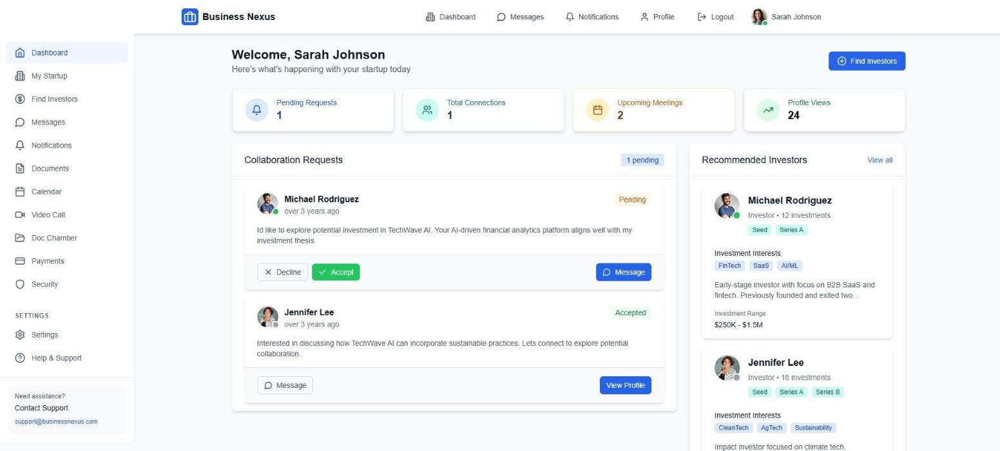

<div align="center">

# Business Nexus

**An investor and entrepreneur collaboration platform, extended with scheduling, video calls, documents, payments and security modules.**

[](https://developershub-nexus-platform.vercel.app/)




</div>

## About

Built during my front-end internship at **DevelopersHub Corporation** (Project 2). Starting from the existing Nexus platform, where entrepreneurs and investors find each other, chat and send collaboration requests, I added five new modules:

| Module | What it does |
| --- | --- |
| **Meeting calendar** | Schedule meetings and view them by week or month (FullCalendar) |
| **Video call** | Call screen with start and end call, mic, camera and screen-share controls |
| **Document chamber** | Upload deal documents, track them as draft, in review or signed, and sign with an e-signature mockup |
| **Payment center** | Deposit, withdraw, transfer, and fund a deal, with a list of transactions |
| **Security center** | Password strength meter, two-step OTP verification and role-based access for entrepreneurs and investors |

The platform also includes sign-in and registration, separate entrepreneur and investor dashboards and profiles, messaging, notifications, deals and settings. Data is mocked on the front end, so no backend is needed to try it.

## Try the demo

Open the [live demo](https://developershub-nexus-platform.vercel.app/), choose **Entrepreneur Demo** or **Investor Demo**, and sign in.

## Tech stack

| Area | Tools |
| --- | --- |
| Framework | React 18, TypeScript, Vite |
| Styling | Tailwind CSS, Lucide icons |
| Routing | React Router |
| Features | FullCalendar, react-hot-toast, date-fns |
| Hosting | Vercel |

## Run it locally

```bash
git clone https://github.com/connectabdullahdev/DevelopersHub-Nexus-Platform.git
cd DevelopersHub-Nexus-Platform
npm install
npm run dev
```

## Project structure

```
src/
├── components/   # layout, UI kit, chat, cards
├── context/      # auth context
├── data/         # mock users, messages, requests
├── pages/
│   ├── calendar/            # meeting calendar (new)
│   ├── videocall/           # video call (new)
│   ├── documents-chamber/   # document chamber + e-signature (new)
│   ├── payment/             # payment center (new)
│   ├── security/            # security center (new)
│   └── ...                  # auth, dashboards, profiles, chat, deals
└── types/
```

---

<div align="center">

Built by **Muhammad Abdullah** during the DevelopersHub Corporation front-end internship · [LinkedIn](https://www.linkedin.com/in/connectabdullahdev) · [GitHub](https://github.com/connectabdullahdev)

</div>
